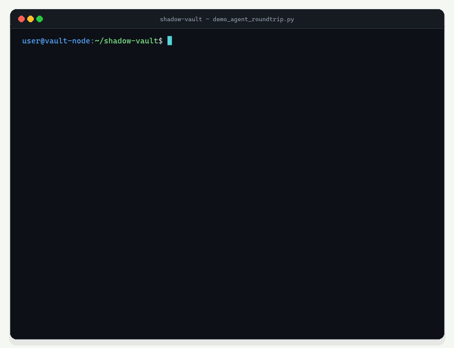

<p align="center">
  
</p>

<h1 align="center">ShadowVault</h1>

<p align="center">
  <strong>The privacy layer for AI agent tool calls and Model Context Protocol (MCP).</strong>
</p>

<p align="center">
  <a href="https://github.com/dhirajparihar/shadow-vault/actions"></a>
  <a href="https://pypi.org/project/shadow-vault/"></a>
  <a href="https://github.com/dhirajparihar/shadow-vault/blob/main/LICENSE"></a>
  <a href="https://dhirajparihar.github.io/shadow-vault/"></a>
</p>

<p align="center">
  
</p>

---

## Stop breaking your AI Agent tools with `[REDACTED]`

Most PII masking libraries were designed for static document redaction, not autonomous AI agents. Replacing sensitive data with `[REDACTED]` or `<EMAIL_1>` completely breaks tool-calling workflows:

1. **Schema & Validator Rejection:** When your AI agent attempts to invoke a Stripe API, PostgreSQL tool, or CRM integration, strict downstream validators (Pydantic, regex schemas, database constraints) immediately crash when handed `[REDACTED_CARD]` instead of a 16-digit numeric card string.
2. **One-Way Irreversibility:** Once data is destroyed by one-way redaction, local tools cannot execute real actions. You cannot process a refund, send an email, or dispatch an SMS with `[EMAIL]`. Bi-directional pseudonymization securely restores real PII at the tool boundary and re-masks outputs before returning to the model.
3. **SSE Streaming Token Tearing:** Naive regex replacements leak torn fragments when modern LLMs stream tokens across Server-Sent Events (SSE) chunks (e.g. streaming `"u_8f"`, then `"9a1@shadow"`, then `".vault"`). `shadow-vault` provides a lookahead holdback buffer that reassembles split tokens seamlessly without token tearing.

---

## Architecture Flow

```
                     +---------------------------------------+
                     |         END USER / CLIENT             |
                     +---------------------------------------+
                                  |                 ^
                1. Raw User PII   |                 |  8. Hydrated Real PII
                   (e.g. Card)    v                 |     (StreamHydrator SSE)
                     +---------------------------------------+
                     |         SHADOW-VAULT PROXY            |
                     +---------------------------------------+
                        |                          ^
      2. Dehydrated     |                          |  7. Dehydrated Tool
         Safe Prompt    v                          |     Return Value
+------------------------------------+    +------------------------------------+
|         CLOUD LLM / AGENT          |    |          LOCAL MCP TOOL            |
| (OpenAI / Anthropic / LangChain)   |    |      (Stripe / SQL / API)          |
+------------------------------------+    +------------------------------------+
           |                                                 ^
           |  3. Model Tool Call with                        |  4. @vault_guard
           |     Synthetic Tokens                            |     Reversible Hydration
           +-------------------------------------------------+
```

---

## Quickstart (12 Lines)

Install the core library (zero heavy NLP dependencies):

```bash
pip install shadow-vault
```

Protect any Python function or agent tool in seconds:

```python
from shadow_vault import ShadowVault, vault_guard

vault = ShadowVault()

# 1. Protect your internal tool: automatically receives real PII, returns masked PII
@vault_guard(vault=vault, session_id_arg="session_id")
def charge_customer(email: str, card: str, session_id: str = "default") -> dict:
    # Function executes with REAL PII: email='alice@example.com', card='4532 0151 1283 0366'
    return {"status": "PAID", "receipt": email, "backup_phone": "+91 9876543210"}

# 2. Dehydrate safe prompt for the LLM:
prompt = vault.dehydrate("Charge alice@example.com on card 4532 0151 1283 0366", session_id="s1")
# Prompt: "Charge u_c09753@shadow.vault on card 4000009995970590"

# 3. Model executes tool using synthetic tokens -> returns sanitized output back to agent state:
result = charge_customer(email="u_c09753@shadow.vault", card="4000009995970590", session_id="s1")
# Result: {'status': 'PAID', 'receipt': 'u_c09753@shadow.vault', 'backup_phone': '+919000597059'}
```

---

## Interactive Zero-Key Terminal Demo

Run the self-contained 4-stage interactive walkthrough (requires NO API keys):

```bash
python examples/demo_agent_roundtrip.py
```

---

## 🎮 Interactive Web Playground

Launch the interactive 3-panel visual playground with real-time token highlighting and latency counters:

```bash
pip install streamlit
streamlit run playground/app.py
```

- **Panel 1 (User & Local MCP Tool)**: Displays raw prompt with real PII and verifies `@vault_guard` restoring real values before local tools execute.
- **Panel 2 (What Cloud LLMs See)**: Highlights format-preserving synthetic `@shadow.vault` tokens in green over the wire.
- **Panel 3 (Live SQLite Vault)**: Inspects the live in-memory mapping table, BLAKE2b deduplication, and sub-millisecond latency counters.
- **Pre-Loaded Scenarios**: Includes *Fintech UPI/PAN Refund Agent*, *Healthcare Patient Booking Agent*, and *DevOps API Key Log Analyzer*.
- 🌐 **Live Online Demo**: [https://dhirajparihar.github.io/shadow-vault/](https://dhirajparihar.github.io/shadow-vault/) *(No install needed)*
- 💻 **Local Streamlit App**: `streamlit run playground/app.py`

---

## Supported Entities (Global + India)

`shadow-vault` uses zero-dependency regexes coupled with **strict mathematical checksum algorithms** so random numbers are never falsely flagged:

| Entity Type | Mathematical Checksum / Algorithm | Real Input Example | Format-Preserving Synthetic Output |
|:---|:---|:---|:---|
| **`CREDIT_CARD`** | **Luhn Checksum (mod 10)** (13–19 digits) | `4532 0151 1283 0366` | `4000009995970590` *(passes Luhn!)* |
| **`AADHAAR`** | **Verhoeff Dihedral $D_5$ Algorithm** | `3675 9834 6016` | `999905970594` *(passes Verhoeff!)* |
| **`PAN_CARD`** | Indian Income Tax Format (`[A-Z]{5}[0-9]{4}[A-Z]{1}`) | `ABCDE1234F` | `SHDWV7059Z` |
| **`UPI_ID`** | Evaluated before email (`@okaxis`, `@okhdfcbank`, `@paytm`, etc.) | `dhiraj@okaxis` | `u_a81c25@okshadow` |
| **`EMAIL`** | RFC-5322 (ignores `@shadow.vault` & UPI handles) | `alice@example.com` | `u_c09753@shadow.vault` |
| **`PHONE`** | E.164, Indian mobile (`+91 [6-9]\d{9}`), US/NANP | `+91 9876543210` | `+919000597059` *(valid 10-digit mobile)* |
| **`SSN`** | US Social Security Number (Area/Group/Serial checks) | `219-45-7890` | `900-99-7059` *(unissued area code)* |
| **`API_KEY`** | OpenAI `sk-...`, GitHub `ghp_...`, Google `AIza...`, Bearer | `sk-abcdef1234567890abcdef...` | `sk-sv-shadow-c0975300000000000000` |

---

## Why `shadow-vault`?

| Capability | `shadow-vault` | Microsoft Presidio | LangChain `PIIMiddleware` |
|:---|:---:|:---:|:---:|
| **Format-Preserving Tokenization** | **Yes** *(Pydantic & regex valid)* | No *(replaces with `<EMAIL>`)* | No *(replaces with `[REDACTED]`)* |
| **Reversible Tool Calls (MCP & Python)** | **Yes** *(auto-hydrates at boundary)* | Manual *(requires custom glue)* | No *(one-way irreversible)* |
| **SSE Stream Safe (Zero Token Tearing)** | **Yes** *(lookahead holdback buffer)* | No *(chunks break tokens)* | No |
| **Zero Heavy NLP Dependencies** | **Yes** *(~0 MB, pure Python + SQLite)* | No *(requires spaCy / PyTorch ~500MB)* | Yes |
| **Mathematical Checksum Validation** | **Yes** *(Luhn & Verhoeff algorithms)* | Partial | No |
| **Thread-Safe Session SQLite Storage** | **Yes** *(built-in with TTL expiration)* | Requires External DB | None |

---

## Framework Integrations

### 1. LangChain & LangGraph

```python
from langchain_core.tools import tool
from langchain_openai import ChatOpenAI
from shadow_vault import ShadowVault, protect_tool, ShadowVaultChatWrapper

vault = ShadowVault()
session_id = "agent_session"

# Protect Tools: Inputs hydrated before execution, outputs dehydrated before returning
@tool
def lookup_db(card_number: str) -> dict:
    """Fetch record from database."""
    return {"card": card_number, "balance": 1500}

safe_tool = protect_tool(lookup_db, vault=vault, session_id=session_id)

# Protect ChatModel: Prompts dehydrated before cloud LLM, tool-call arguments kept synthetic
llm = ChatOpenAI(model="gpt-4o")
safe_llm = ShadowVaultChatWrapper(llm=llm, vault=vault, session_id=session_id)
```

### 2. Model Context Protocol (MCP) Stdio Gateway

Wrap **any** existing MCP server (Node.js, Python, Go, Rust) with a zero-code transparent privacy gateway:

```bash
# Sits between your Agent/Claude Desktop and downstream MCP servers over stdio:
shadow-vault mcp-proxy --session-id user_42 -- uvx mcp-server-sqlite --db /path/to/data.sqlite
```

Claude Desktop / Cursor Configuration (`claude_desktop_config.json`):

```json
{
  "mcpServers": {
    "secure-sqlite": {
      "command": "shadow-vault",
      "args": [
        "mcp-proxy",
        "--session-id", "claude_session",
        "--fail-closed",
        "--",
        "uvx", "mcp-server-sqlite", "--db", "/path/to/database.db"
      ]
    }
  }
}
```

Or intercept programmatic JSON-RPC messages in Python:

```python
from shadow_vault import ShadowVault, MCPVaultInterceptor

vault = ShadowVault()
interceptor = MCPVaultInterceptor(vault=vault)

# 1. Intercept incoming tool call from model (restores real PII before tool executes):
safe_request = interceptor.intercept_request(mcp_request, session_id="user_session")

# 2. Intercept outgoing tool response before it reaches LLM (re-dehydrates result):
safe_response = interceptor.intercept_response(mcp_response, session_id="user_session")
```

---

## 🔒 Enterprise Security: Envelope Encryption & Blind Indexing

Unlike naive caches that store raw sensitive values in plaintext SQLite, `shadow-vault` provides **authenticated envelope encryption at rest** and **cryptographic blind indexing**:

```python
from shadow_vault import ShadowVault, VaultStore

# Enable AES-256-GCM / authenticated encryption at rest:
vault = ShadowVault(
    db_path="./vault.db",
    encryption_key="my-master-vault-encryption-key", # Or via SHADOW_VAULT_KEY env var
)
```

- **Zero Plaintext on Disk:** All `real_val` entries written to SQLite are authenticated ciphertexts (`enc:gcm:v1:...` or `enc:std:v1:...`). Direct inspection of `.db` files reveals zero real PII.
- **HMAC-SHA256 Blind Indexing:** Fast $O(1)$ database lookups without leaking plaintext or search patterns to anyone with read access to the database.
- **Tenant & Session Salting:** Support for custom salts prevents cross-session rainbow table correlation.

---

## 🛡️ Context-Aware Tool Policies & Fail-Closed Protection

Different agent tools require different privacy boundaries. A Slack notification tool should never receive raw credit cards, while a Stripe tool needs card details but not Aadhaar or SSNs:

```python
from shadow_vault import ShadowVault, ToolPolicy, FailClosedAction, vault_guard

vault = ShadowVault(fail_closed=True)

# 1. Restrict hydration by entity type:
stripe_policy = ToolPolicy(
    tool_name="stripe_charge",
    allowed_entities={"CREDIT_CARD", "EMAIL"},
    fail_closed=True,
    fail_action=FailClosedAction.RAISE,
)

# 2. Block hydration completely for untrusted tools:
slack_policy = ToolPolicy(
    tool_name="post_slack_alert",
    allow_hydration=False, # Receives format-preserving synthetic tokens only
)

@vault_guard(vault=vault, policy=slack_policy)
def post_slack_alert(message: str, card: str, session_id: str = "default"):
    # card is guaranteed to remain synthetic (e.g. 4000009995970590)
    ...
```

---

### 3. OpenAI-Compatible FastAPI Proxy Server

Deploy a drop-in proxy for any OpenAI SDK client:

```python
import uvicorn
from shadow_vault import ShadowVault, create_proxy_app

vault = ShadowVault()
app = create_proxy_app(vault=vault, upstream_base_url="https://api.openai.com/v1")

if __name__ == "__main__":
    uvicorn.run(app, host="0.0.0.0", port=8000)
```

Point your client to `http://localhost:8000/v1`:

```python
from openai import OpenAI

client = OpenAI(
    base_url="http://localhost:8000/v1",
    api_key="your-api-key",
    default_headers={"X-Session-ID": "session_42"}
)

# Streaming SSE response with real-time token re-hydration:
stream = client.chat.completions.create(
    model="gpt-4o",
    messages=[{"role": "user", "content": "Send bill to alice@example.com"}],
    stream=True
)

for chunk in stream:
    if chunk.choices[0].delta.content:
        print(chunk.choices[0].delta.content, end="", flush=True)
```

---

## Benchmark & Performance Profile (1,000 Iterations)

Measured on a realistic 2,000-token prompt containing 12 distinct PII entities, structured MCP tool-call dictionaries, and 500-chunk SSE streams using `benchmarks/run_benchmarks.py`:

### Latency Profile

| Workload / Operation | Input Payload Size | P50 Latency | P95 Latency | P99 Latency | Target Met |
|:---|:---|:---:|:---:|:---:|:---:|
| **Dehydrate Prompt (12 Entities)** | ~2,000 tokens (4.6 KB) | **2.876 ms** | 4.043 ms | 4.531 ms | Sub-5ms |
| **Hydrate MCP Tool Arguments** | 5 Synthetic PII Args | **26.6 μs** (0.0266 ms) | 45.9 μs | 73.4 μs | < 0.1 ms |
| **StreamHydrator (Per Chunk)** | 500 Token Chunks | **50.0 μs** (0.0500 ms) | 63.0 μs | 72.3 μs | < 0.1 ms |
| **Full 500-Chunk Stream Total** | 500 SSE Token Chunks | **25.00 ms** | 31.49 ms | 36.16 ms | Real-Time |

### Memory Overhead (`tracemalloc`)

| Metric | Measured Footprint | Comparison vs. Heavy NLP (spaCy / Presidio) |
|:---|:---:|:---|
| **Memory per Active Session** | **0.028 KB** (28 bytes) | ~12,500x lighter (~500 MB model load vs. 0.04 KB) |
| **Peak Heap Overhead (500 Active Sessions)** | **28.56 KB** | Zero GPU / Torch dependencies required |
| **Storage Engine** | **SQLite In-Memory / WAL** | Built-in TTL expiration prunes inactive sessions |

### Checksum Accuracy & False-Positive Rejection

| Test Scenario | Sample Size | False-Positive Rejection Rate | Theoretical Guarantee |
|:---|:---:|:---:|:---|
| **Random 16-Digit IDs (Order & Tracking Numbers)** | 10,000 | **90.03%** | Modulo 10 Luhn algorithm rejects non-card numbers |
| **Random 12-Digit IDs (Transaction References)** | 10,000 | **89.95%** | Verhoeff dihedral group $D_5$ check rejects non-IDs |
| **Single-Digit Substitution & Transposition Errors** | Exhaustive | **100.0%** | 100% mathematical error detection guarantee |

To re-run the benchmark suite locally:

```bash
python benchmarks/run_benchmarks.py
```

---

## Running Tests

```bash
pytest -v
# 54 passed in 1.37s (100% pass rate)
```

---

## Contributing

Contributions are welcome! Read [CONTRIBUTING.md](file:///c:/Users/HP/Desktop/projectios/shadow-vault/CONTRIBUTING.md) to see how you can add a new regional PII detector in under 20 lines of code.

---

## License

Distributed under the MIT License. See [LICENSE](file:///c:/Users/HP/Desktop/projectios/shadow-vault/LICENSE) for details.

